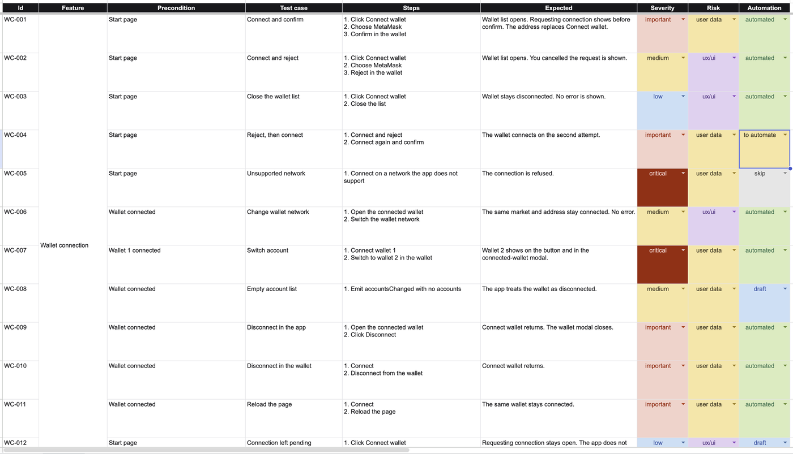
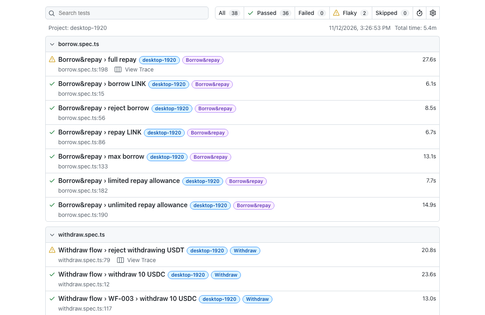

# Aave Playwright demo

This repository demonstrates end-to-end Playwright tests for a typical Web3 DeFi application.

The tests are intentionally basic and do not cover the whole Aave application. The main purpose is to show how Playwright can be used to test Web3 apps, including a mocked wallet, blockchain interaction, test reporting, and test planning.

Copyright (c) 2026 Sergey Krigulson. Licensed under the MIT License.

## Details

- **Application:** [app.aave.com](https://app.aave.com/), configured for the Base Sepolia testnet
- **Framework:** Playwright (TypeScript) and the Page Object Model, written with help from Cursor agents (see the Cursor rules in `.cursor/rules`)
- **CI:** GitHub Actions on a self-hosted runner, on every push to `main`. The workflow is not set up for GitHub-hosted runners.
- **Test plan:** tests are linked to a Google Sheet, and an AI agent can automate cases marked "to automate"

## Requirements

- Node.js 20.20.2 (see `.nvmrc`)
- A test wallet funded with USDC, USDT, and LINK on the Base Sepolia testnet (use the Aave faucet to get the funds)

## How to run

1. Use Node.js 20.20.2 (`nvm use`), install dependencies with `npm ci`, then install browsers with `npx playwright install`.
2. Copy `.env.example` to `.env` and set `RPC_URL_BASE_SEPOLIA`, `WALLET1_PRIVATE_KEY`, and `WALLET2_PRIVATE_KEY`.
3. Run the tests with `npm test`.
4. Open the report with `npm run report`.

The report shows the status, steps, and result of every test, including a trace for every failure.

## Adding new tests

1. Describe the new tests in the test plan.
2. Set the environment variables listed in `.env.example`.
3. Ask your agent to implement the tests marked "to automate".
4. Review and run the tests to confirm they are stable.
5. Push and check the run in GitHub Actions.

## Roadmap

The following improvements can be implemented later:

- Split the mocked wallet (`MockWallet`). The injected provider and the test controls currently live in one class.
- Let `preconditionBuilder` express comparisons such as `<`, `>`, and `<=`. It currently accepts only exact amounts.
- Better test parallelization. Supply, borrow, and withdraw share wallet 1, so they stay serialized. Playwright shards, a wallet per runner, and locks would let more of the suite run at once.
